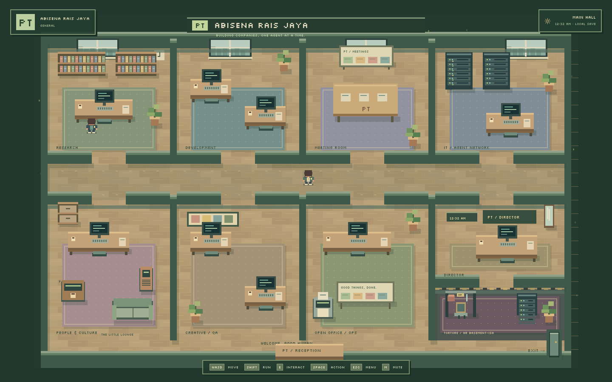

# PT ABISENA RAIS JAYA

**A little office. Big ideas. Real AI colleagues.**

A full-screen top-down pixel office game. Walk to HR, hire a colleague, connect their agent at the IT terminal, assign real work through dialogue, and let them bring you the result. Every management screen lives inside an office device or game menu.



## Revision 2: automation and arcade gameplay

**Recurring tasks are now implemented.** Boss laptop → **Recurring tasks** → **New recurring task**. Supports one-time, daily, weekly/weekday, interval and five-field cron schedules with IANA timezones, pause/resume/edit/delete, run history, bounded retry, provider/model selection and real report delivery. Also accessible through employee dialogue, HR and the whiteboard. [Scheduling guide](docs/RECURRING_TASKS.md).

SPACE now attacks immediately in the facing direction, including empty-space rifle fire. Hold SPACE for automatic rifle fire. Employees have 100 HP: default rifle takes 4 hits, knife 6 and whip 10. Small optional blood pixels, health bars, recoil, hit-stop, layered SFX and persistent bodies are implemented.

Death is **not automatic firing**. At a body or HR, choose **Resurrect / Fire without replacement / Replace similar / Replace completely new / Leave corpse for now**. Food/drinks restore living employees to full HP. A new compact torture room below the boss office contains seven configurable cartoon machines with persistent assignment, stop/release, stats and incidents. [Gameplay guide](docs/GAMEPLAY.md).

Existing saves upgrade automatically without resetting staff or provider profiles. For an existing Supabase project, also apply `supabase/migrations/20261006213943_scheduler_combat_and_torture.sql` after the original migration. No new `.env` variables are needed for automation or gameplay.

## Revision 3: one PT, many businesses

The company is now a holding. Open several **businesses**, each a whole different office with its own people, work, reports, recurring schedules, torture room, incidents and branding. Walk to the exit door (bottom-right, `EXIT →`) and press **E** for the **PT Lobby**, or use **Boss laptop → Businesses**, to switch. Agent providers, all options and the director (appearance, inventory, consumables) are shared across the PT; each business keeps its own staff, tasks, analytics and office look. Every business keeps running in the background while you stand in another.

Existing saves upgrade automatically — your current office becomes the first business. For an existing Supabase project, apply `supabase/migrations/20261015000000_multi_office.sql` after the earlier migrations (adds per-office ids, the branding table, and the Command Code provider kind).

## Quick start

**Node.js 22.13+ required; Node 24 recommended.** Uses Node's built-in SQLite. No Docker required.

```bash
npm install
cp .env.example .env
npm run dev
```

Open **http://127.0.0.1:5173**. One command starts Vite and the local agent server on `127.0.0.1:3001`.

The game works immediately with an empty company and durable local save. No login required. Music and sound files are bundled. Click **ENTER OFFICE** to unlock browser audio.

### Your first day

1. **WASD / arrows** to walk; **Shift** to run. Click floor for pathfinding movement.
2. Head to **People & Culture**, lower-left room. Approach HR computer; **E**.
3. **Hire employee**: name, role, department, appearance and instructions. Hiring offline is supported.
4. Visit **IT / Agent Network**, upper-right room. **E → Add provider → Save → Test connection**.
5. Return to HR, edit employee, select provider and model under **Agent connection**.
6. Walk up to colleague. **E → Talk** for real chat, or **Assign task** for work.
7. They walk to a workstation, invoke the actual provider, then approach you with a saved report.
8. **Read → Discuss / Revise / Approve**. Printer and boss laptop retain every report.

The tutorial can be skipped. The company has no pre-hired roster.

## AI credentials

Use the in-game **IT terminal**, or configure backend `.env`:

```dotenv
OPENAI_API_KEY=your_openai_api_key
OPENAI_MODEL=gpt-4.1-mini
```

**ChatGPT Plus/Pro is not an API credential.** API access and billing can be separate.

For actual coding/tool work, start OpenCode in your project:

```bash
opencode serve --hostname 127.0.0.1 --port 4096
```

Add **OpenCode server** at IT, base URL `http://127.0.0.1:4096`, test, choose a discovered `provider/model`, and grant employee tools in HR. Optional task project path selects an OpenCode workspace. OpenAI and compatible adapters are text-generation connections; they do not pretend to edit files or execute tools.

Command Code's own CLI can be a provider too. Install and log in once (`npm i -g command-code`, `cmd login`), then add **Command Code CLI** at IT and test connection to list models. The server runs `cmd` headlessly, streams replies and tool activity, and resumes the CLI session. Granting `bash`/`write`/`edit` lets an assignment modify files; the CLI's `cmd login` is the only credential needed.

Local/third-party endpoints: choose **OpenAI-compatible**, supply base URL (usually ending `/v1`), optional API key/custom headers and model.

See [provider setup](docs/AGENT_PROVIDERS.md) for full instructions, cancellation and troubleshooting.

## Controls

| Input | Action |
| --- | --- |
| WASD / arrows | Walk, default 6 tiles/sec |
| Shift | Run, 8.75 tiles/sec |
| E | Interact with nearest person/device |
| Space | Immediate directional attack, with or without a target; hold for rifle autofire |
| Esc | Pause/menu or close current window |
| M | Mute/unmute |
| Mouse | Click floor to walk; click object/person to approach and interact |
| Tab / ↑ ↓ / Enter | Focus, navigate dialogue choices, select |

Typing disables movement. Core keys are remappable in **Esc → Controls**. Touch movement buttons appear on small screens.

## In-world systems

- **Office:** research, developer desks, meeting room, IT, HR, creative/QA, open office/operations, pantry, lounge, boss office, reception, printer and whiteboard. Shared collision grid and A*; short corridors.
- **Businesses:** one PT holding several offices. Switching via the exit door or Boss laptop replaces the whole roster, work and branding on screen while shared providers/options continue across the PT. Each business runs its own schedules in the background.
- **Employees:** user-created profiles, modular appearance, HP, five departments, tool permissions, morale/energy/relationship/stress/productivity, idle coffee trips, healing, resurrection, replacements and employment history. Capacity: 20 positions including unresolved deceased staff, four workstations per department.
- **Tasks:** durable prioritized queues; real workstation arrival before execution; streamed output/tool activity; error details, retry, cancel, pause-as-cancel and saved clarifications; report delivery/revisions/approval.
- **Recurring tasks:** server-side one-time/daily/weekly/interval/cron, timezone/DST, durable occurrence claims, no overlapping runs, bounded retry, history, pause/resume/edit/delete and selectable report output. Works with browser closed while server remains running.
- **Chat:** persistent conversations, streaming, cancel, retry, new conversations and bounded model context.
- **Meetings:** 1–6 available employees physically gather; sequential real-agent contributions; stored transcript, model-produced summary/decisions/actions; convert actions to real tasks.
- **Boss computer:** pixel desktop with company, tasks, employees, reports, finance, analytics, meetings, network and settings. Analytics uses saved task/chat usage only; unknown counts/costs are marked unavailable.
- **Whiteboard:** live Kanban, projects, employee/department status, meetings and editable goals.
- **Customization:** character layers, employee outfits, company motto, wall accents and lush/dormant plant palette.
- **Audio:** licensed recorded music, functional jukebox, separate master/music/SFX/ambient/dialogue volumes, mute, shuffle and repeat.
- **Options:** day/local-time/night, pixel scale, text scale, camera follow, rain, glow, CRT/scanlines, reduced motion, shake, damage flash, contrast and movement/text/animation speeds.
- **Inventory/cartoon consequences:** coffee boost, food/drink full healing, nonlethal fists, damaging whip/knife/rifle, morale changes and incidents. Full/Reduced/Off plus blood toggle. Bodies persist until explicit HR resolution; dead/terminated employees cannot execute agents.
- **Torture room:** automatic whip, boxing glove, knife, target practice, fictional shock chair, endless meeting and paperwork treadmill; physical arrival, configurable intensity, stop/resume/release, persistent sessions, incidents and death resolution. No accumulated offline damage.

## Saves and secrets

State is stored server-side in **`.local-data/office.sqlite`**, not browser localStorage. Core changes save immediately; NPC/player position checkpoints save every five seconds. **Esc → Save** forces a checkpoint.

Provider keys, OpenCode password and custom headers use AES-256-GCM in a separate SQLite vault table. The generated key is `.local-data/vault.key` (or backend `VAULT_KEY`); directory/file permissions are restricted. Back up the **whole data directory with server stopped**, including key. Losing the key means re-entering provider credentials.

The backend binds to loopback, validates Host/Origin, rejects cross-site requests, and requires a per-server session token for mutations. Browser receives provider metadata only. Vite explicitly blocks HTTP access to `.local-data`, `.test-data`, SQLite files, vault keys and environment files. This is a trusted single-user local application, not a multi-user hosted service.

### Optional Supabase

Configure `SUPABASE_URL` and backend-only `SUPABASE_SERVICE_ROLE_KEY`, then apply the included migrations. SQLite remains the immediate offline save; records and complete restore snapshots replicate to Supabase. Unreachable database errors appear in **Company** and local saves remain usable.

Follow **[docs/SUPABASE_SETUP.md](docs/SUPABASE_SETUP.md)**. No public/anon key is needed by this frontend. No remote database is modified by `npm install` or `npm run dev` without your configuration.

## Verification

```bash
npm test                  # Isolated backend, HTTP adapter and persistence tests
npm run build             # TypeScript + production frontend build
npx playwright install chromium
npm run test:e2e           # Isolated server + full browser game flows
```

If Chrome is installed, tests discover `/usr/bin/google-chrome`; override with `PLAYWRIGHT_CHROMIUM_EXECUTABLE=/path/to/browser`. Tests use ports **5175/3101**, isolated temporary saves, and an explicitly labeled **DEMO SIMULATION** provider. The live OpenAI test runs only when `OPENAI_API_KEY` exists in the test process. It performs a small billed API request.

Production frontend preview: `npm run dev:server` in one terminal, `npm run preview` in another. Normal local play uses `npm run dev`.

More: [testing notes](docs/TESTING.md), [architecture](docs/ARCHITECTURE.md), [reference research](docs/REFERENCES.md), [audio](docs/AUDIO.md), [asset manifest](ASSETS.md), [credits](CREDITS.md).

## Source layout

```text
apps/game/src/        Phaser world, original art, audio, state bridge, pixel UI
apps/server/src/      Fastify API, agent adapters, engine, SQLite/vault, Supabase sync
packages/shared/src/ Typed records/events, office geometry, collision and A*
public/audio/        Licensed music and effects, bundled for local playback
public/office.tmj    Tiled-compatible export of the canonical office map
supabase/migrations/ Complete Postgres schema, indexes, constraints and RLS
tests/               Backend, browser, and SQL verification
docs/                Setup, architecture, research, screenshots
```

Canonical map is `packages/shared/src/world.ts`; `npm run map:export` refreshes the Tiled file. Tiled round-trip editing and multiplayer are not implemented. Previous prototype `src/` and its documentation are retained for provenance; current entry point exclusively uses `apps/`.

## Honest integration boundaries

- Provider-less AI actions say **NO AGENT PROVIDER CONNECTED**. Optional `ENABLE_DEMO_PROVIDER=true` adds a visibly labeled simulation for testing; off by default.
- Pausing cancels generation, preserving work/session. Retry starts another provider turn; it is not a provider-native suspended computation. Clarification is included on retry/revision.
- OpenCode permission requests are surfaced; approve them in the OpenCode client attached to that server, or cancel in-game.
- Real AI output depends on supplied credentials, provider/model capabilities and OpenCode permissions. Automated local HTTP/SDK protocol tests do not claim live credential verification.
- Supabase is a single-writer replica/restore path, not conflict-resolving multi-machine synchronization.
- Scheduled work needs the local server/computer/provider running. Downtime coalesces missed slots into one catch-up run. Task failures and unavailable employees are recorded, not replaced with generated fake results.
